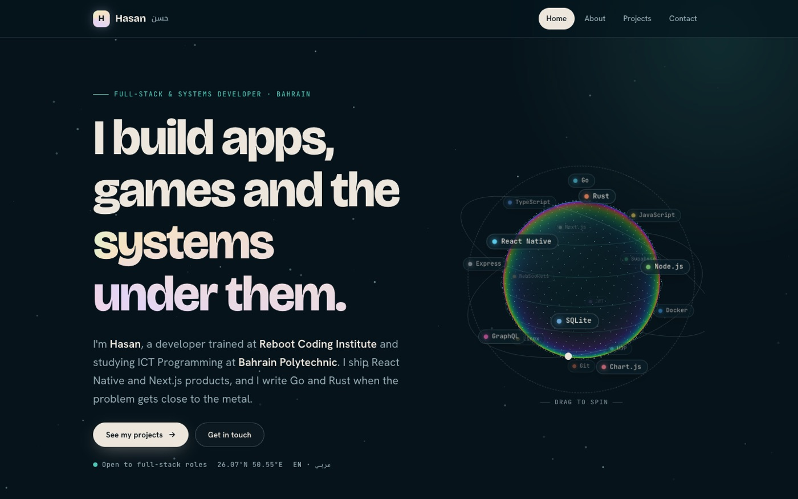

<div align="center">



# Hasan Abdulla · Portfolio

**My first portfolio site: hand-written HTML, CSS and JavaScript with an animated canvas background.**

    

[**Visit the site**](https://hasanabdulla.vercel.app)

</div>

## Pages

| Page | What's on it |
|---|---|
| **Home** (`index.html`) | Intro, the path from business studies to software, and a few featured projects |
| **About** (`about.html`) | Experience (Esbitar, Exceeders, Reboot Coding Institute), the tools I build with, and research highlights |
| **Projects** (`projects.html`) | Mobile apps, websites and games, grouped by type |
| **Contact** (`contact.html`) | How to reach me |

## Details

- No framework and no build step: four HTML pages, one stylesheet and one script
- An animated "tide" canvas behind the content and a page-load curtain transition
- Bricolage Grotesque, Hanken Grotesk and JetBrains Mono for type, with Noto Kufi Arabic for Arabic text
- Deployed on Vercel as a static site

## Your photo

Put your photo in `images/` as `me.jpg`. The path is set in `app.js` (`CONFIG.photo`). Until the file exists, the "H" monogram shows instead.

## Run locally

```bash
npx serve .
```

---

<div align="center">

Built by **Hasan Abdulla** · [github.com/hx03s](https://github.com/hx03s) · Bahrain 🇧🇭

</div>
